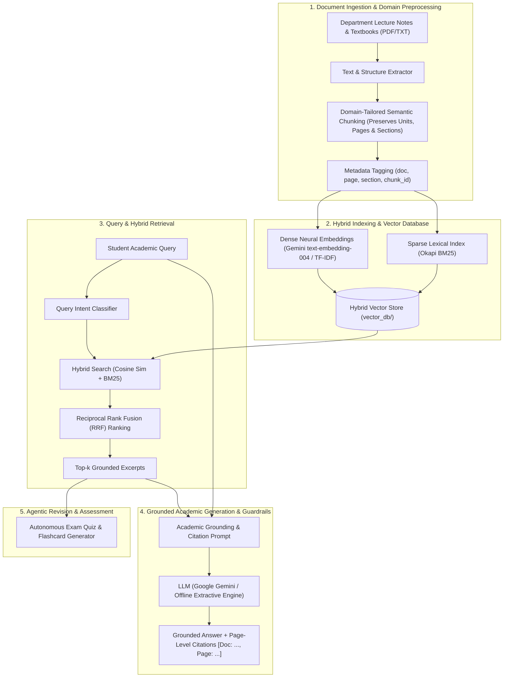

# 🎓 Academic Doubt-Solving RAG System
> **A Retrieval-Augmented Generation (RAG) Chatbot built on an LLM for Subject-Specific Academic Doubt-Solving**

---

### 📌 Project Metadata
- **Student Name:** Lanka Jeeshita
- **Project Supervisor / Guide:** Dr. P. Sudhakar
- **Domain / Specialization:** Generative AI & Agentic AI Systems
- **Deliverable:** 24x7 Academic Query Assistant for Students & Faculty
- **Keywords:** academic, doubt solving, retrieval augmented generation, vector embeddings, agentic AI, LLM

---

## 🏛️ System Architecture



---

## 🚀 Key Technical Features

1. **Academic Domain Preprocessing:**
   - Detects academic unit and chapter headers (`Unit 1`, `Section 1.1`, `Definition`, `Theorem`).
   - Prevents breaking mathematical formulas and tables across arbitrary byte boundaries.
   - Preserves page numbers and structural provenance for verifiable citations.

2. **Hybrid Retrieval (Dense + BM25 with RRF):**
   - Dense embeddings capture conceptual semantics.
   - Okapi BM25 accurately matches exact technical terms, formulas, and acronyms (`RAG`, `LLM`, `Softmax`, `d_k`).
   - Combined via Reciprocal Rank Fusion:
     $$\text{RRF}(d) = \sum_{m} \frac{w_m}{60 + \text{rank}_m(d)}$$

3. **Zero-Hallucination & Verifiable Citations:**
   - Answers are strictly anchored to the course material.
   - Every factual assertion cites the exact document and page number: `[Doc: Course_Notes.txt, Page: 1]`.

4. **Dual Operational Modes:**
   - **Live Generative Mode:** Connects to Google Gemini API (`gemini-2.5-flash`, `gemini-1.5-flash`).
   - **Offline Extractive Mode:** Fully operational even without an API key or internet access, ideal for offline lab exams and viva defenses!

5. **Agentic Quiz & Flashcard Generator:**
   - Automatically formulates university-style Multiple Choice Questions (MCQs) and revision flashcards directly from lecture notes.

6. **Interactive Streamlit Web Dashboard:**
   - Modern, professional interface designed for students and educators.
   - Includes real-time RAG Triad diagnostics (Context Relevance, Faithfulness, Answer Relevance).

---

## 📂 Project Directory Structure

```text
academic_rag_assistant/
│
├── app.py                      # Main Streamlit web application
├── init_db.py                  # Database initialization and pre-indexing script
├── test_query.py               # Retrieval verification script
├── run_app.bat                 # One-click Windows application launcher
├── requirements.txt            # Python dependencies
├── .env.example                # Sample environment configuration
├── README.md                   # Project documentation & architecture
│
├── src/                        # Core algorithmic modules
│   ├── __init__.py
│   ├── preprocessor.py         # Academic text extraction & semantic chunker
│   ├── vector_engine.py        # Dense, BM25, and Hybrid RRF vector engine
│   ├── rag_agent.py            # Academic prompting, intent classifier & answer generator
│   └── quiz_generator.py       # Autonomous exam MCQ and flashcard generator
│
├── sample_notes/               # Pre-loaded course materials
│   └── GenAI_Agentic_Systems_Course_Notes.txt
│
└── vector_db/                  # Persistent vector index & chunk metadata
    ├── chunks_metadata.json
    ├── embeddings.npy
    └── vocab.json
```

---

## 💻 How to Run the Project

### Option A: One-Click Execution (Windows)
Simply double-click the [`run_app.bat`](file:///C:/Users/DIVYA/.gemini/antigravity/scratch/academic_rag_assistant/run_app.bat) file located in the project directory.

### Option B: Terminal Execution
Open PowerShell or Command Prompt in the project folder and run:
```powershell
py -3.13 -m streamlit run app.py
```
The application will launch automatically in your web browser at:
`http://localhost:8501`

---

## 🎯 Sample Questions to Test During Demo

1. **Conceptual Understanding:**
   > *"What is the difference between standard LLMs and Agentic AI Systems?"*
2. **Formula Derivation:**
   > *"What is the mathematical equation for Scaled Dot-Product Attention and why is the scaling factor 1/sqrt(d_k) needed?"*
3. **Architecture & Justification:**
   > *"Why is RAG preferred over fine-tuning for resolving academic doubts?"*
4. **Hybrid Retrieval:**
   > *"Explain how Reciprocal Rank Fusion (RRF) combines dense and sparse search."*
